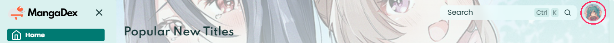
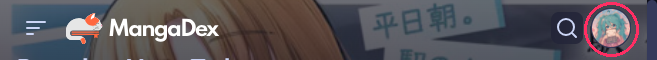
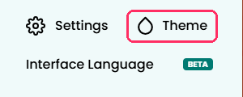
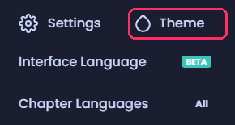
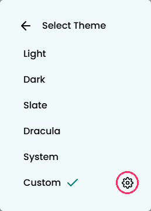
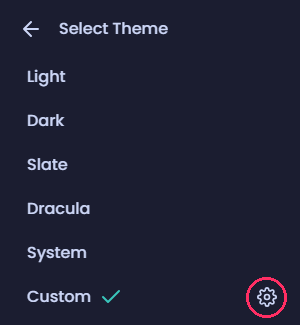
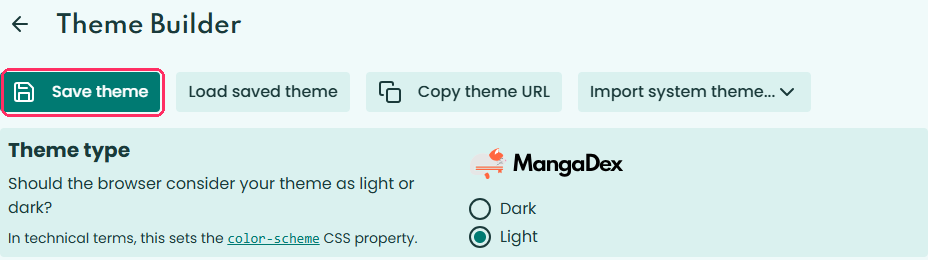
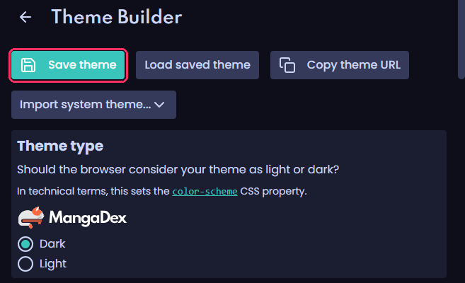
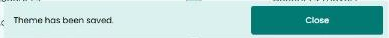
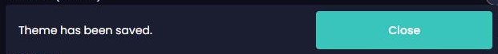

# Hatsune Miku for MangaDex

MangaDex keeps a custom theme in a link. Opening one puts the theme on for now; four taps make it stay.

| Look | Background / Primary | Link |
|---|---|---|
| Hatsune Miku Dark | `#0d0e1a` / `#39c5bb` | [Open in MangaDex](https://mangadex.org/?theme=AAMxLjEBAQIAA_bWzP8EGg4N_wUwHRv_BkAoJf8HHREQ_whFKyj_CVQ1Mf8KKhgX_wtbOjX_DHtPR_8NJBUU_w5nQjz_D4RWTv8QRiwo_xFtRj__EntPR_8TPSYj_xR5TUb_FYxeVv8WQikm_xeoeXD_GFs6Nf8ZWzo1_xpnQjz_G1s6Nf8cMB0b_x27xTn_Hqu0Pv8fkJdA_yCIav__IbvFOf8iEr___yP_mXP_JKh5cP8l_4fL_yb_mXP_J4hq__8odFnd_yljSsL_) |
| Hatsune Miku Light | `#f0fafa` / `#007a72` | [Open in MangaDex](https://mangadex.org/?theme=AAMxLjEBAAIAAzo6Gv8E-vrw_wXv8dr_Bt_hv_8H0NKv_wjq7M__Cd3fvv8K0tSx_wvl58f_DNTXtP8Nx8mk_w7f4cD_D8rMqP8QvsCb_xHZ27n_EsHDnv8Tq6yF_xTS1LL_Fa-xif8WoqR8_xdwcEr_GAQEAP8Z7_Ha_xrl58f_G-_x2v8c5efH_x1yegD_HmRrBv8fTFIK_yBAANT_IXJ6AP8iAGiZ_yPDUAD_JHBwSv8lyRyO_ybDUAD_J0AA1P8oMwSt_ykoAI__) |
| Sakura Miku Dark | `#130d14` / `#e87ea1` | [Open in MangaDex](https://mangadex.org/?theme=AAMxLjEBAQIAA-jW8P8EFA0T_wUtGSj_Bj4iNv8HGg4X_whBJTv_CUovSP8KKBQj_wtPNE__DGFJa_8NJBEc_w5VO1n_D2lQc_8QQiY8_xFZQF__EmFJa_8TPCA0_xRfR2n_FXJXfP8WPyM4_xeQcJr_GE80T_8ZTzRP_xpVO1n_G080T_8cLRko_x2hfuj_HpN10v8ffGWt_yB3Vv__IbvFOf8iRrX__yP_l4X_JJBwmv8l_7ul_yb_l4X_J3dW__8oZEbc_ylUN8H_) |
| Sakura Miku Light | `#fff5f8` / `#cc4477` | [Open in MangaDex](https://mangadex.org/?theme=AAMxLjEBAAIAAygUOv8E-PX__wXr4_r_BtjL7f8Hx7ji_wjm2_b_CdfK7P8Kyrvk_wvf0_L_DMy-5f8Nva3a_w7YzO3_D8Cw3f8QtKLR_xHRxOn_Erem1P8Tn4u8_xTKu-T_FaSRwf8WloGz_xdgRHr_GAAAAP8Z6-P6_xrf0_L_G-vj-v8c39Py_x13RMz_Hmo_tf8fVTSP_yBAANT_IWV4AP8iAGaZ_yPQMBL_JGBEev8l91gy_ybQMBL_J0AA1P8oMwSt_ykoAI__) |
| Snow Miku Dark | `#031121` / `#95caed` | [Open in MangaDex](https://mangadex.org/?theme=AAMxLjEBAQIAA_7kzP8EIRED_wUyIhH_Bj8uHf8HJBQF_whDMSD_CU88K_8KLR0M_wtVQjD_DG1ZRv8NKRkI_w5dSjj_D3VgTf8QRDIh_xFiTzz_Em1ZRv8TPSwb_xRrV0T_FX9pVP8WQS8e_xetj3P_GFVCMP8ZVUIw_xpdSjj_G1VCMP8cMiIR_x3typX_Htq7jP8fuKB8_yCJbf__IbvFOf8iEr___yP_mnX_JK2Pc_8l_4fL_yb_mnX_J4lt__8odVzd_ylkTcP_) |
| Snow Miku Light | `#f5faff` / `#05598b` | [Open in MangaDex](https://mangadex.org/?theme=AAMxLjEBAAIAAzYoGv8E__r1_wX77eH_BufZzP8H18m8_wj159n_CebYy_8K2cu__wvu4NP_DNzOwf8NzL-y_w7o2s3_D8_Ctf8QwrWp_xHg08b_Esa4rP8TrJ-T_xTZzL__FbGkmP8WpJaJ_xdzYlL_GAEAAP8Z--3h_xru4NP_G_vt4f8c7uDT_x2LWQX_HnhMBP8fVzYC_yBAANT_IXJ6AP8iAGmb_yPDUAD_JHNiUv8lyRyO_ybDUAD_J0AA1P8oMwSt_ykoAI__) |
| Kasane Teto Dark | `#160e0e` / `#da646a` | [Open in MangaDex](https://mangadex.org/?theme=AAMxLjEBAQIAA9vd7v8EDg4W_wUdHif_BikqM_8HEREZ_wgtLTf_CTg4Qv8KGRki_ws9PUj_DFNUX_8NFRUe_w5FRlD_D1pbZ_8QLi44_xFJSlX_ElNUX_8TJygx_xRRUl3_FWJjb_8WKys1_xeHiJj_GD09SP8ZPT1I_xpFRlD_Gz09SP8cHR4n_x1qZNr_HmFcxP8fUU6e_yCJbf__IbvFOf8iEr___yP_mXP_JIeImP8l_4fL_yb_mXP_J4lt__8odVzd_ylkTcP_) |
| Kasane Teto Light | `#fff7f6` / `#c13c51` | [Open in MangaDex](https://mangadex.org/?theme=AAMxLjEBAAIAAyQkLP8E9vf__wXp6fH_BtXV3f8HxMXM_wji4-r_CdPU2_8Kx8jP_wvc3eT_DMnK0f8NurvC_w7V1t3_D72-xf8QsbG5_xHOz9b_ErS0vP8Tm5uj_xTHyM__FaCgqP8WkpKa_xddXmf_GAAAAP8Z6enx_xrc3eT_G-np8f8c3N3k_x1RPMH_Hkg2qv8fOSyF_yBAANT_IXJ6AP8iAGmb_yPDUAD_JF1eZ_8lyRyO_ybDUAD_J0AA1P8oMwSt_ykoAI__) |

## Keep the theme

The same steps on a computer and on a phone. The pictures show Hatsune Miku Light on a computer and Hatsune Miku Dark on a phone; the pink frame marks what to tap.

| Step | Computer | Phone |
|---|---|---|
| 1. Open the link for your look. The site turns into it right away, but only for now. |  |  |
| 2. Tap your avatar in the top right corner, then **Theme**. |  |  |
| 3. Tap the gear next to **Custom**. On a phone, tap the dark area on the left to close the menu. |  |  |
| 4. The Theme Builder shows the look from the link. Tap **Save theme**. |  |  |
| 5. MangaDex says the theme has been saved. It stays from now on. |  |  |

Open the Theme Builder this way, from the page the link opened. Going to mangadex.org/theme directly shows the theme you saved before, not the one from the link, and Save theme stays grey.

To go back to a built-in theme, open the avatar menu, Theme, and pick Light, Dark or another one. Your saved theme stays under Custom.

The links are generated from the palette by `bun tools/mangadex/build.ts`. Do not edit this file by hand.
